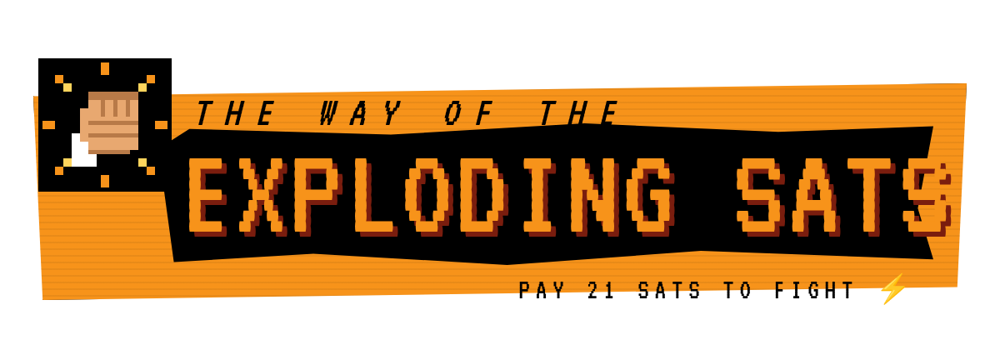
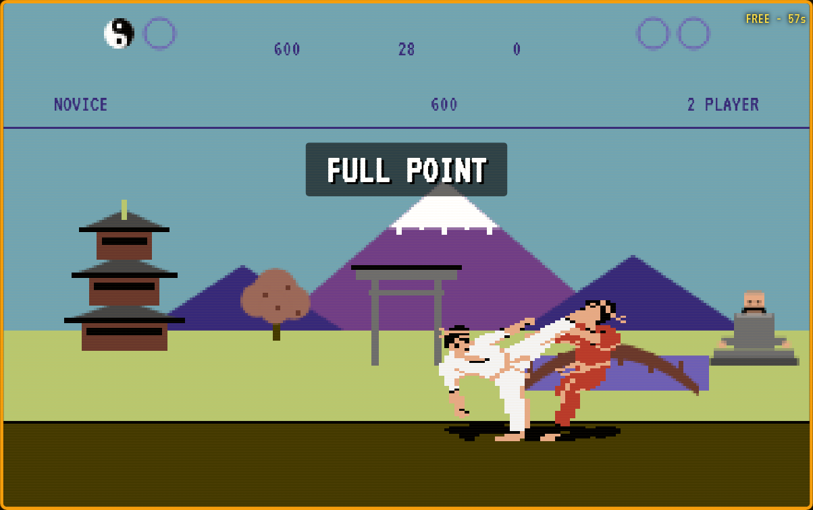

<p align="center"></p>

**Exploding Sats** is a retro one-on-one karate game for the browser where bouts are won on points, paid for with Bitcoin Lightning and ranked on Nostr.

Pay 21 sats to fight. Publish your grade and score to the decentralized leaderboard.



## Features

- **Joystick controls** - 8-way joystick plus one fire button. Direction alone walks, jumps, crouches, punches and somersaults; direction with fire kicks: flying kick, high/mid/jab kick, forward and backward sweep, roundhouse (release early for an about-face) and high back kick. All directions are facing-relative.
- **Point scoring** - every landed blow knocks the opponent down for a full yin-yang (clean hit) or half a yin-yang (poor hit). First to two full points wins the bout. Remaining seconds on the 30 second clock pay 100 points each.
- **Grading** - Novice, then 1st to 10th Dan. Each grade is two bouts; win both and you are promoted to a new arena and a sharper opponent. Lose a bout and the match is over.
- **Four arenas** - pagoda and torii gate under Fuji, the seaside, the dojo, and the Great Buddha, with the seated sensei judging from the sidelines.
- **Bull bonus round** - after the fourth arena a bull charges in. Somersault over it or stop it with a low punch on the nose.
- **Two-player mode** - four bouts, highest total score wins.
- **Attract mode** - the game boots into a CPU vs CPU demo.
- **Lightning payments** - 21 sats per match via any Lightning wallet (NWC, WebLN or invoice).
- **Nostr leaderboard** - scores signed by the game key and published as Gamestr events.
- **Free play mode** - one minute to try the moves (scores not publishable).

## How to Play

1. **Pay to fight** - click "Pay 21 sats to fight" and pay with your Lightning wallet.
2. **Move** - a 3x3 letter grid: `Q W E / A D / Z X C` are the eight joystick directions and left `Shift` is fire (arrow keys and `Space` also work). Gamepads work (stick or D-pad plus any button). On touch devices a virtual joystick and fire button appear.
3. **Fight** - see the MOVES dialog in-game for the full chart. Sweeps can't be blocked, so jump them. Duck the flying kick. Hold back to block.
4. **Compete** - login with Nostr and save your score to the leaderboard.

Player 2 uses `P [ ] / L ' / , . /` with right `Shift` (or `Enter`) as fire.

## Tech Stack

Same stack as [Space Zappers](https://spacezappers.com):

- React 18 + TypeScript + Vite
- TailwindCSS + shadcn/ui
- Nostrify (Nostr protocol)
- LNbits (Lightning payments via LNURL-pay)
- HTML5 Canvas at 320x200, pixel-scaled

## Development

```bash
npm install
npm run dev      # game on http://localhost:8088, score service on 8089
npm run test     # TypeScript, ESLint, Vitest, score-service tests, then production build
npm run build
```

Create `.env.local` with the score service settings (see `.env.example`):

```
GAME_NSEC=nsec1...
LIGHTNING_ADDRESS=your.game@your-lnbits-instance
LNBITS_URL=https://your-lnbits-instance
LNBITS_INVOICE_KEY=<invoice/read key of the receiving wallet>
VITE_GAME_PUBKEY=<64-char-hex-pubkey>
VITE_LIGHTNING_ADDRESS=your.game@your-lnbits-instance
```

The LNbits key is read by the score service at runtime and is never part of the browser bundle. Only public values belong in `VITE_*` variables.

## Lightning Payment Flow

1. The game asks the score service for an invoice (`POST /api/lightning/invoice`); the service resolves the Lightning address (LNURL-pay) server-side.
2. The player pays with any Lightning wallet.
3. The game polls `GET /api/lightning/payments/<hash>`, which checks LNbits with the invoice key and returns only `{ paid }`.
4. The match starts.

`GET /api/lightning/health` reports whether LNbits is reachable (cached 60s). While it says `unavailable` the game shows "Lightning payments are temporarily unavailable" and disables the pay buttons; free play still works.

## Nostr Integration

Scores use the [Gamestr](https://gamestr.io) kind 30762 event, signed by the game's key so players cannot forge scores. The `level` tag holds the grade index (0 = Novice, 10 = 10th Dan). See [NIP.md](./NIP.md).

## Deployment

A single container serves the game (nginx) and the score/payment service (Node.js). If either process exits, the container exits so Docker restarts it. Secrets are runtime environment variables, never build args:

```bash
docker build -t exploding-sats \
  --build-arg VITE_LIGHTNING_ADDRESS=your.game@your-lnbits-instance .
docker run -d --name exploding-sats -p 3005:80 \
  -e GAME_NSEC=nsec1... \
  -e LIGHTNING_ADDRESS=your.game@your-lnbits-instance \
  -e LNBITS_URL=https://your-lnbits-instance \
  -e LNBITS_INVOICE_KEY=<invoice key> \
  exploding-sats
```

On black-panther the container is defined in the apps-stack docker-compose (see CLAUDE.md).

## Project Structure

```
├── src/
│   ├── pages/Game.tsx             # Payment flow, input, overlays, leaderboard
│   ├── components/
│   │   ├── FistCanvas.tsx         # 320x200 world scaled 3x with HUD text
│   │   ├── JoystickControls.tsx   # Touch joystick + fire
│   │   └── ui/                    # shadcn/ui components
│   ├── lib/
│   │   ├── fistEngine.ts          # Rules, moves, AI, scoring, bull round
│   │   ├── fighterSprites.ts      # Fighter pose data
│   │   ├── fighterAnimation.ts    # Per-move sprite sequences
│   │   ├── fistRenderer.ts        # Arenas, sensei, fighters, bull, HUD
│   │   └── fistAudio.ts           # Kiai, crack, thud, SID-style music
│   └── hooks/
│       ├── useGameScores.ts       # Leaderboard queries
│       └── useLNbitsPayment.ts    # Invoice + payment polling
└── score-service/                 # Score signing microservice (kind 30762)
```

## Branding

`docs/logo.png`, `docs/screenshot.png`, `docs/social-preview.png` and `public/og-image.png` are rendered by `scripts/render-branding.js` from the HTML templates in `docs/branding/` (VT323 pixel font, Bitcoin orange on black, the fist from the favicon). Re-run it with the dev server up whenever the look changes:

```bash
node scripts/render-branding.js
```

## Credits

Built with [MKStack](https://soapbox.pub/mkstack).
